  
  
  



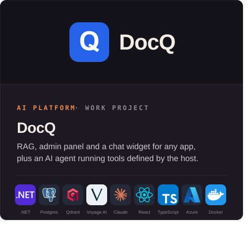<a href="https://github.com/Blackkoutt/music-label-ops">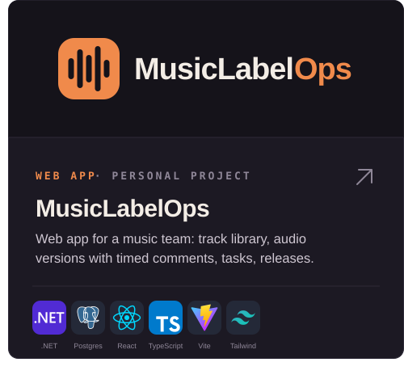</a>
<a href="https://github.com/Blackkoutt/EventFlow">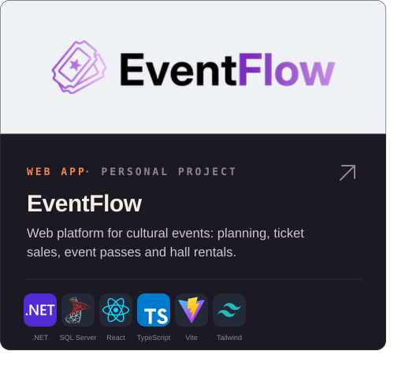</a><a href="https://github.com/Blackkoutt/TeslaGo">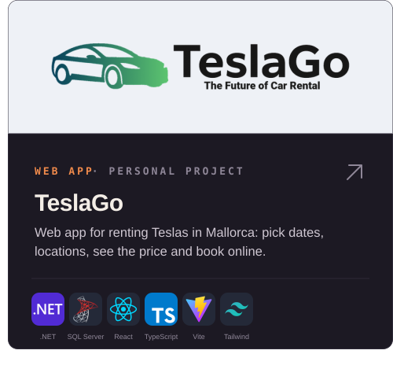</a>

<picture>
  <source media="(prefers-color-scheme: light)" srcset="https://raw.githubusercontent.com/Blackkoutt/Blackkoutt/output/github-snake.svg" />
  
</picture>

